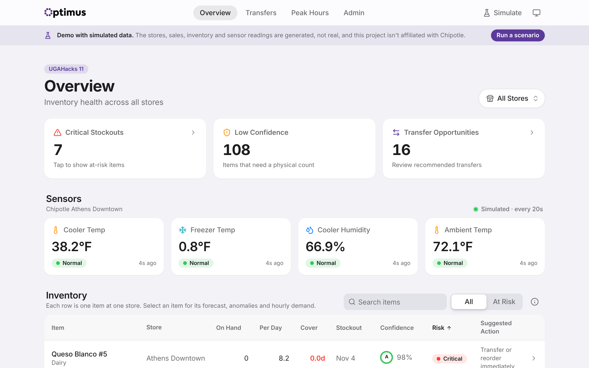
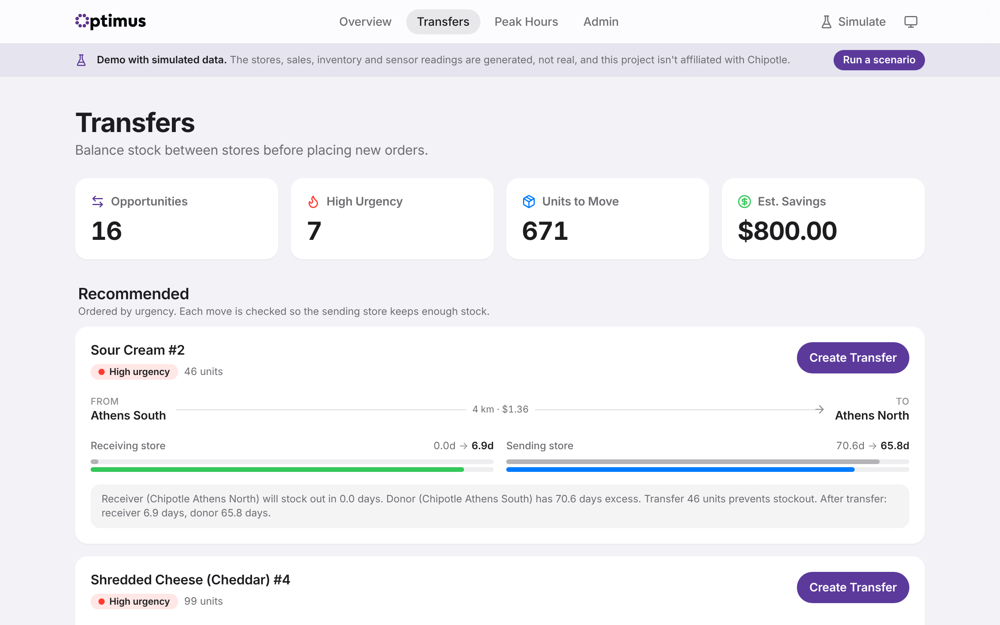
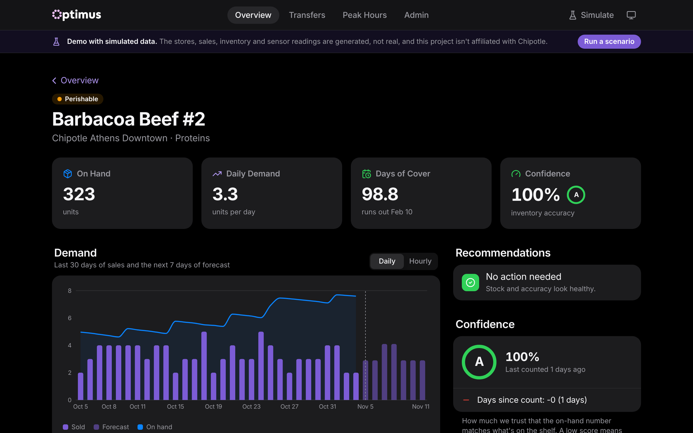
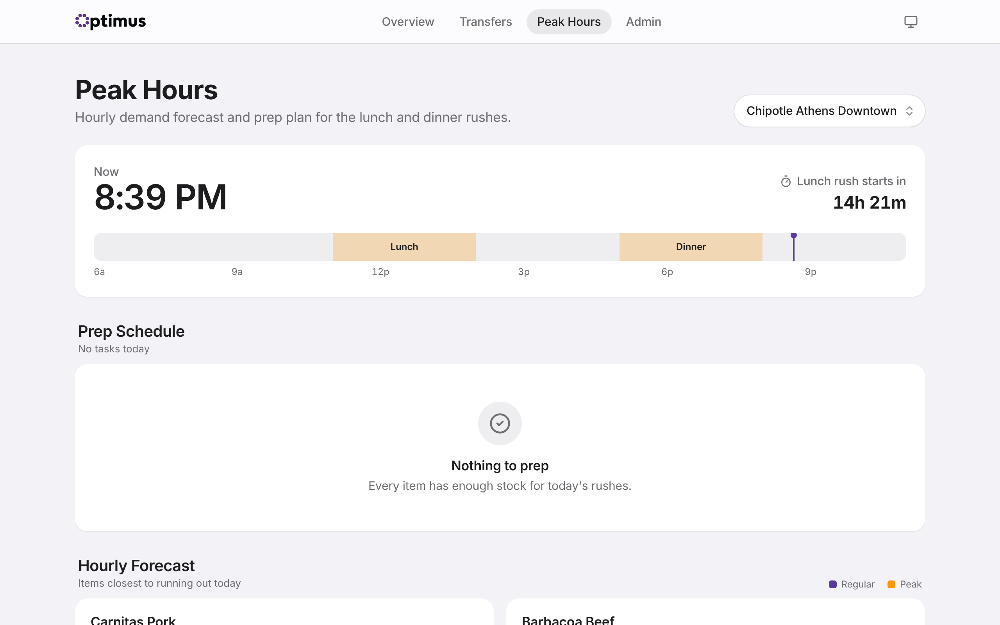
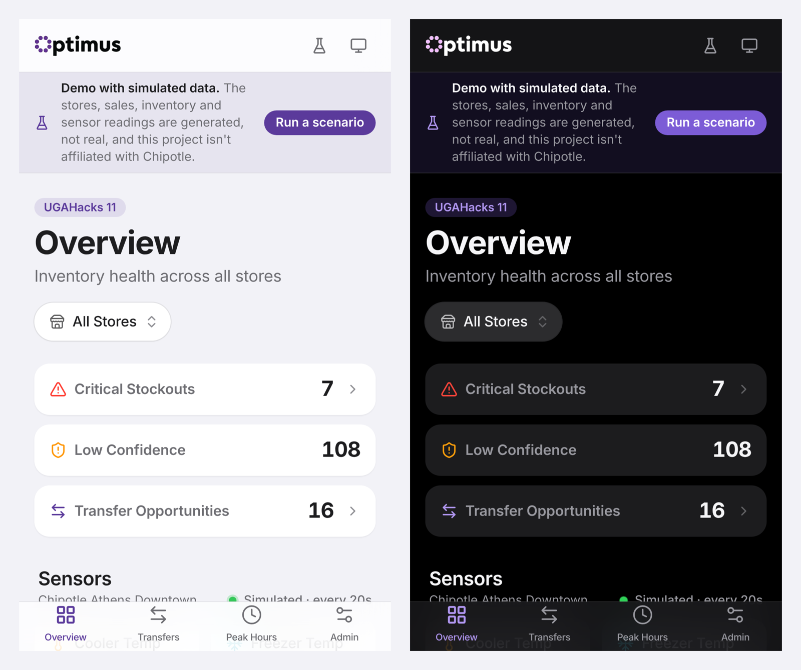
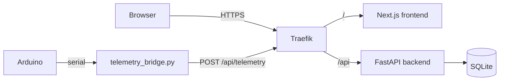

# Optimus

Optimus is an inventory health dashboard for restaurant chains. It predicts which ingredients are about to run out at each store, flags inventory that disappeared without a sale to explain it, and recommends moving stock from a nearby store before anyone places a new order.

**Live demo:** [optimus.jmistry.com](https://optimus.jmistry.com)

Everything on the demo is simulated. The stores, sales, inventory and sensor readings are generated, and the project isn't affiliated with Chipotle. Use **Run a scenario** on any page to trigger an event, like a cooler failure or a catering order, and watch the dashboard react.

We built the first version at UGAHacks 11, and I've kept working on it since. Specifically, I redesigned the UI, made the API about five times faster, deployed it on my own server and ran a full security audit.

<picture>
  <source media="(prefers-color-scheme: dark)" srcset="docs/screenshots/overview-dark.png">
  
</picture>

## What it does

- **Stockout prediction.** Forecasts daily demand for every item at every store and turns it into days of cover and a predicted stockout date.
- **Anomaly detection.** Compares how much stock should have changed (sales, deliveries, transfers) with how much it actually changed, and explains any gap in plain English.
- **Confidence scoring.** Grades how much you can trust each on-hand number from A to F, so managers know which items to physically count first.
- **Transfer recommendations.** Finds stores with extra stock close to a store that's running low, and walks a transfer through approval, shipping and receiving.
- **Peak hours.** Forecasts demand by the hour for the lunch and dinner rushes and builds a prep schedule from it.
- **Live sensors.** An Arduino posts cooler, freezer and humidity readings that show up on the dashboard. Since the hackathon it's been replaced by a simulator that behaves the same way.
- **Simulation.** A background simulator generates each new day of sales, deliveries and counts so the demo never goes stale, and four scenarios let visitors trigger events that undo themselves a few minutes later.

| | |
|---|---|
|  |  |
|  |  |

## How it works



The frontend and the API sit on one domain. Traefik sends `/api` to FastAPI and everything else to Next.js, so the browser never makes a cross-origin request. Everything runs as two containers on [Dokploy](https://dokploy.com).

The analytics are deliberately simple rules, and each one can explain its result:

| Feature | How it's calculated |
|---|---|
| Demand forecast | Weighted moving average of the last 28 days, with weekdays and weekends averaged separately and blended 5 to 2. Recent days count more (decay 0.95 per day). |
| Anomalies | Expected change = deliveries − sales + transfers in − transfers out. If the actual change is more than 5 units below that, it's flagged, and the size of the gap sets the severity. |
| Confidence score | Starts at 100 and loses points for recent anomalies, units lost, days since the last physical count, perishables that haven't been counted recently, and a repeating shrink pattern. |
| Transfers | Each store aims for 10 days of cover. A store only donates what it has beyond that plus a 2 day buffer, and donors are ranked by `surplus / (1 + distance / 100 km)`. |
| Peak hours | Averages the same hour on past days, adds a 15% buffer during the rushes, then steps inventory forward hour by hour to find when it runs out. |

## Design decisions

**Explainable rules instead of a machine learning model.** We had synthetic data and a weekend, so there was nothing real to train on. More importantly, a store manager won't act on a number they don't trust. So every anomaly comes with a sentence explaining it, and every confidence score lists the deductions behind it. If this ever ran on real sales data, the forecast would be the first thing I'd swap for a trained model.

**Recommend a transfer before a reorder.** Moving stock from a store 8 km away is faster and cheaper than a new supplier order, and it uses up product that would otherwise expire somewhere else. The donor rule makes sure a transfer never puts the sending store at risk.

**FastAPI and Next.js as separate apps.** The forecasting and scoring logic is easier to write and test in Python, and FastAPI generates the [API docs](https://optimus.jmistry.com/docs) for free. The frontend is TypeScript, so the shape of every API response is typed in one place (`frontend/src/lib/types.ts`).

**SQLite.** It needs no setup and lives in one file on a Docker volume, which fits a demo. The tradeoff is a single writer, so the API runs one worker. The schema is plain SQLAlchemy, so moving to Postgres would mostly mean changing the connection string.

**Making the API fast without changing any answers.** The overview page took 3 to 4 seconds because it ran the forecast about 3,500 times per request, each with its own query. Now each request loads the sales, anomaly and cycle count data in a few bulk queries up front, and the scoring code reads from memory. I only accepted the change after checking that the output was identical for all 1,000 store and item pairs. The overview now loads in about 0.6 seconds.

**Keeping a finished demo alive.** Every page reads "yesterday's" inventory, so a data set generated once went blank the day after. Now a simulator runs inside the API. It fills in each missing day by continuing every item's own weekday and weekend demand, and reorders when stock runs low. It also does occasional cycle counts and injects the odd unexplained loss. Before trusting it, I simulated six weeks ahead and checked that the dashboard still looked like a normal week: a few stockout risks and a couple dozen transfer opportunities, with most items in good shape.

**Scenarios that clean up after themselves.** The scenario buttons are public, so every change a scenario makes is written to a journal as a delta, and it's undone exactly when the scenario ends or expires. I tested that by running overlapping scenarios, ending them in a different order and checking that the database matched its original state byte for byte. They're also rate limited per visitor and capped site-wide.

**Calibrate sensors at the source.** The demo temperature sensor sits at room temperature, not in a cooler, so its readings need a −20°C offset. That offset used to live in the frontend and got applied to every reading, including demo data that was already realistic, so the dashboard showed 0°F and "Critical." Now the Arduino bridge applies it before posting, and the database only ever stores real cooler temperatures.

**A small design system instead of a component library.** The UI follows Apple's Human Interface Guidelines: grouped lists, a type scale, one accent color, and status colors only where they mean something (red for critical, green for normal). Every color is a CSS variable with a light and a dark value, so dark mode follows the system by default and has a manual toggle. The components (`frontend/src/components/ui`) are small enough that I know exactly what each one does.

**Secure by default in production.** The dashboard is a public demo, so reading data is open. Wiping the data needs an admin token and posting sensor readings needs a device key. If either secret isn't set in production, the endpoint turns itself off instead of staying open. More on that in [SECURITY.md](SECURITY.md).

## How I use AI

I use an AI coding agent (Claude Code) the way I'd use a fast junior developer who never gets tired of the boring parts. It doesn't decide what Optimus does or how it should work. I make those calls, and I use it to get the tedious work done faster.

Here's what that looked like on this project:

- **Setup and config.** When I deployed to Dokploy, it wrote the production Dockerfiles, the compose file and a step-by-step guide. I set up the server, DNS and domains myself.
- **Carrying out decisions I'd already made.** For the redesign, I chose the direction (Apple-style, keep the purple accent, a dark mode toggle that follows the system, keep the UGAHacks branding) and approved a page-by-page plan before it touched any code. Then it handled the repetitive work of applying that across five pages.
- **Verification I'd otherwise skip.** It takes screenshots of every page in light and dark mode on desktop and phone, runs browser tests on every control, and wrote `check_endpoints.sh` so I can check the live site after every deploy. That's how bugs like the stockout warning showing up four months early got caught.
- **Research.** It looked up which dependency versions fixed which vulnerabilities, and checked that each one had been out for at least two weeks before I upgraded.

I don't take its output on faith. A change has to prove itself first, the same way the performance fix had to produce identical results for every store and item before I accepted it. When it finds something outside what I asked for, like the sensor calibration bug, it tells me and I decide whether to fix it.

## Tech stack

| Layer | Tools |
|---|---|
| Frontend | Next.js 16, React 19, TypeScript, Tailwind CSS, Recharts, Lucide icons |
| Backend | Python 3.11, FastAPI, SQLAlchemy, Pydantic |
| Data | SQLite |
| Hardware | Arduino with a DHT sensor, Python serial bridge |
| Infrastructure | Docker, Dokploy, Traefik, Let's Encrypt |

## Running it locally

You need Docker.

```bash
git clone https://github.com/jaydenmistry/optimus.git
```

```bash
cd optimus && docker compose up --build
```

Then open [localhost:3000](http://localhost:3000) for the dashboard and [localhost:8000/docs](http://localhost:8000/docs) for the API. The backend generates the demo data set (5 stores, 200 items, 60 days of history) the first time it starts, which takes about 20 seconds. After that the simulator keeps it current and posts sensor readings every 20 seconds.

To turn the simulator off, for example when a real sensor is connected, set `SIMULATION_ENABLED=false`. The simulator also steps aside on its own for any sensor that a real device has posted to in the last few minutes.

## Deploying

[DEPLOY_DOKPLOY.md](DEPLOY_DOKPLOY.md) walks through deploying to your own server with Dokploy, from DNS to HTTPS. Once it's up, this checks every page, API route and security header:

```bash
./check_endpoints.sh https://your-domain.com
```

## Security

- Admin and sensor endpoints need a secret, and they're disabled in production if the secret isn't set.
- Every page gets a nonce-based Content Security Policy, plus HSTS and the other standard security headers.
- Both containers run as non-root users on a read-only filesystem with Linux capabilities dropped.
- Production dependencies have no known vulnerabilities as of November 2026.

[SECURITY.md](SECURITY.md) has the full audit: what I found, how each issue was fixed, and the risks that remain.

## Project structure

```
backend/
  app/api/          REST endpoints
  app/services/     forecasting, anomaly detection, confidence, transfers, peak hours
  app/security.py   auth for write endpoints and security headers
  app/simulation/   daily roll-forward, simulated sensors, demo scenarios
frontend/
  src/app/          pages (overview, transfers, item detail, peak hours, admin)
  src/components/   design system and app shell
  src/proxy.ts      per-request Content Security Policy
hardware/           Arduino sketch and serial-to-API bridge
plans/              original hackathon planning notes
```

## Contact

Jayden Mistry · [jayden@jmistry.com](mailto:jayden@jmistry.com)
